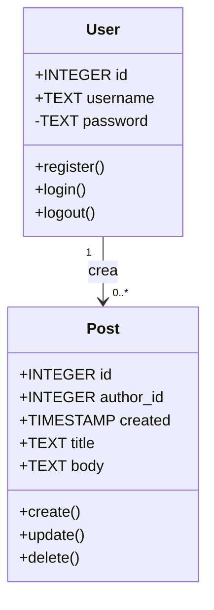

# Diagrama de classes - Projecte Flaskr

## Objectiu

Aquest document representa el diagrama de classes
del projecte Flaskr. Mostra les classes User i Post,
els seus atributs, mètodes i les seves relacions.

## Diagrama UML

